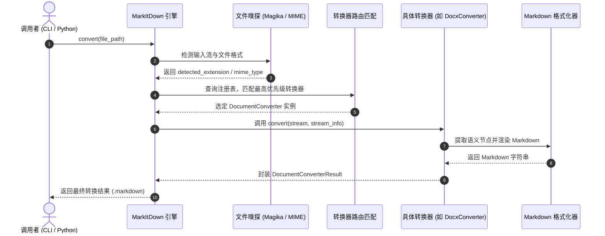

# 第二章：系统架构与技术原理解析

---

## 2.1 整体架构设计（Architecture Overview）

MarkItDown 采用经典的**分层门面模式（Facade Pattern）**与**转换器插件工厂模式（Converter Factory Pattern）**，保证了高内聚与低耦合的设计原则。

```
+-------------------------------------------------------------------------+
|                              调用层 (Entrypoints)                       |
|       [CLI 命令行: markitdown]          [Python SDK: MarkItDown()]      |
+------------------------------------+------------------------------------+
                                     |
                                     v
+-------------------------------------------------------------------------+
|                           核心门面调度器 (Facade)                        |
|                                MarkItDown                               |
|        - 统一转换接口: convert(), convert_stream(), convert_local()      |
|        - 插件加载管理: PluginManager & EntryPoints                      |
+------------------------------------+------------------------------------+
                                     |
       +-----------------------------+-----------------------------+
       | (格式嗅探路由: Magika + 扩展名 + MIME Type + 优先级策略)     |
       v                                                           v
+---------------------------------------+  +------------------------------+
|     内置转换器矩阵 (Built-in Converters)  |  |   扩展与云端服务 (Extensions)  |
|                                       |  |                              |
|  - PdfConverter     (pdfminer/plumber)|  |  - markitdown-mcp (MCP 服务) |
|  - DocxConverter    (mammoth)         |  |  - markitdown-ocr (Vision)   |
|  - XlsxConverter    (pandas/openpyxl) |  |  - Azure DocIntelligence     |
|  - PptxConverter    (python-pptx)     |  |  - Azure ContentUnderstanding|
|  - HtmlConverter    (markdownify/bs4) |  +------------------------------+
|  - Audio/WavConverter (SpeechRecog)   |
|  - ZipConverter     (递归遍历管道)      |
+---------------------------------------+
```

---

## 2.2 核心解析流水线流程 (Execution Pipeline)

当用户发起一次 `md.convert("sample.docx")` 调用时，内部完整处理生命周期如下：



---

## 2.3 关键技术与底层组件原理解析

### 1. 基于 Google Magika 的智能文件嗅探
传统转换工具强依赖文件后缀名，极易因文件名篡改、临时无后缀文件或错误扩展名而报错。
MarkItDown 集成了 Google 开源的 **Magika** 深度学习格式检测模型，通过直接扫描文件前导字节（Magic Bytes）和二进制特征，精准识别文件真实 MIME 类型。

### 2. 转换器核心基类与生命周期 (`_base_converter.py`)
所有的转换器均继承自 `DocumentConverter` 抽象基类，必须实现核心方法：
```python
class DocumentConverter:
    def accepts(self, file_stream: BinaryIO, stream_info: StreamInfo, **kwargs) -> bool:
        """根据文件流特征和扩展名判断是否接受该文件"""
        pass

    def convert(self, file_stream: BinaryIO, stream_info: StreamInfo, **kwargs) -> DocumentConverterResult:
        """执行流式解析并返回包含 markdown 属性的结果对象"""
        pass
```

### 3. 各格式专用解析引擎矩阵
- **Word 转换 (`_docx_converter.py`)**：基于 `mammoth` 库，专注于将 OpenXML 的样式标签直接映射为 HTML 语义元素，再经由 `markdownify` 转化为标准 Markdown，彻底杜绝样式冗余。
- **Excel 转换 (`_xlsx_converter.py`)**：结合 `openpyxl` 和 `pandas`，按工作表（Sheet）提取数据块，并自动生成对齐规整的 GFM（GitHub Flavored Markdown）表格。
- **PDF 转换 (`_pdf_converter.py`)**：运用 `pdfminer.six` 和 `pdfplumber`，综合提取文本字符物理坐标和表格网格边框，还原多栏排版与表格结构。
- **递归复合文件 (`_zip_converter.py`)**：将 ZIP 压缩包视为复合容器，内部递归实例化转换器链条，按层级树生成目录索引与各子文件的 Markdown 内容。

---

## 2.4 安全沙箱与防护设计 (Security Considerations)

MarkItDown 在设计上执行严格的安全最佳实践：
1. **进程特权受限原则**：不以 Root 权限常驻，严格以调用进程的局部权限执行只读 I/O。
2. **最小化调用粒度**：针对不可信来源数据，提供 `convert_local()`（受限本地）、`convert_stream()`（仅内存流）等精细化接口，防止 SSRF 网络请求渗透或路径穿越（Path Traversal）。
3. **XML 实体注入防御**：引入 `defusedxml` 代替标准库，彻底封堵恶意 XML 炸弹（Billion Laughs Attack）与外部实体扩展（XXE）风险。
